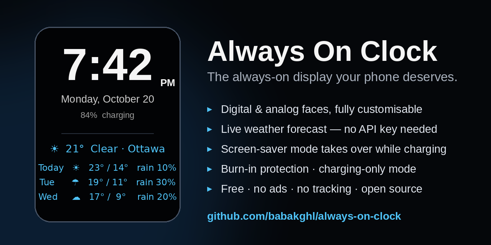

# Always On Clock



[](https://github.com/babakghl/always-on-clock/releases)
[](https://github.com/babakghl/always-on-clock/releases)
[](LICENSE)
[](https://github.com/babakghl/always-on-clock/stargazers)

**[⬇ Download the APK](https://github.com/babakghl/always-on-clock/releases/download/v4.0/AlwaysOnClock.apk)** — Android 8.0+ · Free · No ads · No tracking

A highly customisable always-on display (AOD) clock for Android — big readable time, date, battery and a live weather forecast, designed to sit on a nightstand or desk.

## Features

- **Clock** — digital or analog face, 12/24-hour format, optional seconds, date, battery level with charging indicator; place the clock above, below, left, or right of the weather
- **Daily off-schedule** — the screen goes fully blank on a schedule you set (e.g. off at midnight, back on at 06:00) and comes back on its own
- **Night-brightness schedule** — automatically dims to a level you choose overnight (defaults 22:00–06:00 at 10%)
- **Weather forecast** — powered by [Open-Meteo](https://open-meteo.com) (free, no API key needed) or OpenWeatherMap (bring your own key)
  - 1–7 forecast days
  - Toggle each item: current temperature, condition, daily high, daily low, precipitation chance
  - City search or device location, °C/°F, adjustable refresh interval
  - Icon styles: emoji, simple symbols, or none
- **Live preview** — the top of the Settings screen shows the clock and updates as you change options
- **Categorised settings** — collapsible sections: Clock, Appearance, Weather, Display & Behaviour, Background
- **Screen-saver mode** — set Always On Clock as your Android screen saver and it takes over when the phone idles while charging or docked — the closest an app can get to replacing the built-in AOD
- **Charging-only mode** — the clock shows only while plugged in and exits when you unplug; Settings stay reachable any time (open the app, or use the ⚙ on the screen saver / the notification's Settings action)
- **Background status notification** — a persistent notification shows the clock is running, with the time and current weather; it also keeps the forecast fresh
- **Burn-in protection** — the clock face drifts by an adjustable distance (0–60 dp) at an adjustable interval (30 s – 5 min)
- **Appearance** — clock size, clock and background colours, 6 fonts, bold text, in-app brightness
- **Orientation lock** — auto, portrait, or landscape
- No ads, no tracking, no account

## Install

Grab the ready-made APK from the [Releases page](https://github.com/babakghl/always-on-clock/releases) and install it on your phone (Android 8.0+, minSdk 26), or build from source (below). You'll need to allow "install from unknown sources" for your file manager/browser the first time.

## Build

This project deliberately builds **without Gradle**. A small shell script drives `aapt2`, `javac`, `d8`, `zipalign` and `apksigner` directly:

Requirements:

- JDK 17
- Android SDK with platform `android-34` and build-tools `34.0.0`
- Point `ANDROID_SDK` / `JAVA_HOME` appropriately for your machine (see the top of `build.sh`)

```bash
./build.sh
# → dist/AlwaysOnClock.apk
```

The script signs with `debug.keystore` in the project root (generated on first build if absent). That key is intentionally **not** committed — if you fork this, your build gets its own key, which means your APK can't update-install over someone else's build.

## Permissions

| Permission | Why |
|---|---|
| `INTERNET`, `ACCESS_NETWORK_STATE` | Fetching weather data |
| `POST_NOTIFICATIONS` | The background status notification (Android 13+) |
| `ACCESS_COARSE_LOCATION` | Only if you enable device location for weather |
| `FOREGROUND_SERVICE` | Keeps the status notification and weather updates running |

## License

MIT — see [LICENSE](LICENSE).
